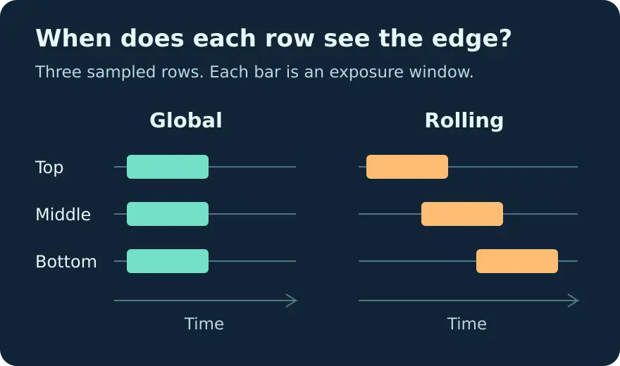

# Global shutter vs rolling shutter in Python

Calculate how far a moving vertical edge shifts between the top and bottom of an image. Change one input at a time and separate row timing skew from exposure blur.



## Start from zero

1. Install Python 3.10 or later from [python.org](https://www.python.org/downloads/). On Windows, keep the Python launcher enabled.
2. On the repository page, choose **Code**, then **Download ZIP**. Extract it. Open a terminal inside the extracted folder containing `shutter.py`.
3. Check `python3 --version`, then run the commands below. On Windows, use `py -3` in place of `python3`. No packages, camera or credentials are needed.

```sh
python3 shutter.py examples/conveyor.json
python3 shutter.py examples/short-exposure.json
python3 shutter.py examples/reverse-scan.json
python3 shutter.py examples/short-roi.json
python3 -m unittest discover -s tests -v
```

| Scenario | Row span (ms) | Rolling skew (px) | Global skew (px) | Blur in either mode (px) |
| --- | ---: | ---: | ---: | ---: |
| Conveyor | 8 | 9.6 | 0 | 1.2 |
| Short exposure | 8 | 9.6 | 0 | 0.3 |
| Reverse scan | 8 | -9.6 | 0 | 1.2 |
| Short ROI | 2 | 2.4 | 0 | 1.2 |

Copy a JSON example and change one input. `rows` is the ROI height in sensor rows sampled sequentially, `line_interval_us` is the delay between neighboring exposure starts, and `exposure_us` is how long each row integrates. `speed_px_s` is signed image speed, positive to the right. `first_row` is `top` or `bottom` in the coordinate system you are modeling. A positive skew puts the bottom of the edge farther right than the top.

## Troubleshooting

If Python cannot open the file, change to the extracted folder. JSON keys require double quotes and no trailing comma. Enter time in microseconds: 1 ms is 1000 µs. Enter image speed in pixels per second. Do not copy a frame period into the row interval. If you know a sensor's total readout time, use its documentation to determine whether it can be converted to row spacing in the current mode.

## Scope and diagram sources

The model assumes constant horizontal image speed, a vertical edge and equally spaced row starts. It does not generate sensor images, validate a camera, simulate noise, or choose strobe settings. A global shutter can still blur. See the [manufacturer's shutter notes](https://docs.baslerweb.com/electronic-shutter-types) for device dependent timing and flash window details.

The two drawings are synthetic. Their editable SVG sources are in `diagrams/`. To regenerate an optimized WebP with Inkscape and ImageMagick installed:

```sh
inkscape diagrams/shutter-row-windows.svg --export-filename=/tmp/shutter-row-windows.png
convert /tmp/shutter-row-windows.png -strip -quality 86 diagrams/shutter-row-windows.webp
```

Full tutorial: https://wifarobotics.com/learn/global-shutter-vs-rolling-shutter/
